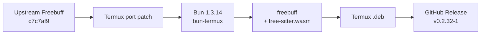

<div align="center">

# Freebuff for Termux

**A native Bionic aarch64 build of the Freebuff terminal coding agent.**

No proot. No glibc shim. No npm launcher.

[](https://github.com/emonbudc/freebuff-bionic/actions/workflows/build.yml)
[](https://github.com/emonbudc/freebuff-bionic/releases/latest)
[](LICENSE)
[](#requirements)

</div>

---

> [!NOTE]
> **Status:** compiles, installs from `.deb`, and launches the Freebuff TUI on
> Termux aarch64. Authenticated agent runs have not been exhaustively tested.
> This is an independent community port, not an official Codebuff or Freebuff
> release.

## Contents

- [Why this port](#why-this-port)
- [At a glance](#at-a-glance)
- [Install](#install)
- [Quick start](#quick-start)
- [What gets installed](#what-gets-installed)
- [Build from source](#build-from-source)
- [How the port works](#how-the-port-works)
- [Verify a release](#verify-a-release)
- [CI and releases](#ci-and-releases)
- [Updating](#updating)
- [Project layout](#project-layout)
- [Troubleshooting](#troubleshooting)
- [Known limitations](#known-limitations)
- [Security](#security)
- [Contributing](#contributing)
- [License](#license)

## Why this port

Termux runs on Android's **Bionic libc**, not glibc. Freebuff's public npm
launcher downloads glibc Linux binaries, which cannot execute natively inside
Termux.

This project builds a real Android aarch64 executable from a pinned Freebuff
snapshot, replaces the native TUI layer with AndroidTUI's Bionic build, and
packages the result as a Termux `.deb`.

## At a glance

| | |
| --- | --- |
| **Package** | `freebuff 0.2.32-1` |
| **Upstream** | [`CodebuffAI/freebuff@c7c7af9`](https://github.com/CodebuffAI/freebuff/commit/c7c7af99f6e244fa8f002848b3b334d8ad8a663c) |
| **Runtime** | Bun `1.3.14` from [`bd-loser/bun-termux`](https://github.com/bd-loser/bun-termux) |
| **TUI layer** | AndroidTUI `0.5.1` |
| **Platform** | Termux / Android `aarch64` |
| **Download** | [Latest release](https://github.com/emonbudc/freebuff-bionic/releases/latest) |
| **Installed size** | ~131 MB binary + assets; ~33 MB compressed `.deb` |
| **Root required** | No |

Validated on Termux `0.119.0-beta.3` (`aarch64`). The installed binary reports:

```text
$ freebuff --version
0.2.32
```

## Install

### Requirements

- Termux installed from [F-Droid](https://f-droid.org/packages/com.termux/) or
  [GitHub releases](https://github.com/termux/termux-app/releases), not the Play
  Store build.
- Android device with `aarch64` userspace (`uname -m` prints `aarch64`).
- About 150 MB of free storage during installation.
- Termux packages: `ca-certificates`, `coreutils`, `curl`, `dpkg`, `git`,
  `ripgrep`, and `termux-tools`.

```bash
pkg update
pkg install ca-certificates coreutils curl dpkg git ripgrep termux-tools
```

### Install the latest release

```bash
curl -fsSL https://raw.githubusercontent.com/emonbudc/freebuff-bionic/main/install.sh | bash
```

The installer resolves the latest GitHub release, downloads the `.deb` and its
SHA-256 file, verifies the checksum, and installs with `dpkg`.

### Install a specific version

```bash
bash install.sh 0.2.32
```

The argument accepts either `0.2.32` or the full release tag `0.2.32-1`.

### Uninstall

```bash
dpkg -r freebuff
```

## Quick start

Run Freebuff from the project you want it to work on:

```bash
cd ~/projects/my-app
freebuff
```

On first use, complete the login flow in your browser. You can also invoke it
explicitly:

```bash
freebuff login
```

If the browser does not open, install `termux-tools` and retry; otherwise copy
the login URL into any device browser.

## What gets installed

Everything lives under the Termux prefix, normally
`/data/data/com.termux/files/usr`.

| Path | Purpose |
| --- | --- |
| `$PREFIX/bin/freebuff` | Symlink used to launch the CLI |
| `$PREFIX/lib/freebuff/freebuff` | Compiled Bionic aarch64 executable |
| `$PREFIX/lib/freebuff/tree-sitter.wasm` | Required tree-sitter runtime asset |
| `$PREFIX/share/doc/freebuff/copyright` | Upstream `LICENSE` and `NOTICE` |

`tree-sitter.wasm` must stay beside the executable. The binary resolves it from
`dirname(process.execPath)`.

## Build from source

### Prerequisites

```bash
pkg install ca-certificates coreutils curl dpkg git python ripgrep termux-tools
```

Install the pinned Bun runtime:

```bash
curl -fL -o "$TMPDIR/bun.deb" \
  https://github.com/bd-loser/bun-termux/releases/download/v1.3.14-patched/bun_1.3.14-patched_aarch64.deb
dpkg -i "$TMPDIR/bun.deb"
bun --version
```

Expected output: `1.3.14`.

### Build the package

```bash
git clone https://github.com/emonbudc/freebuff-bionic.git
cd freebuff-bionic
bash termux/ci/build-local.sh
```

The build fetches the pinned upstream commit, applies the Termux patch, installs
dependencies with the frozen lockfile, compiles the executable, and creates:

```text
dist/freebuff_0.2.32-1_aarch64.deb
dist/freebuff_0.2.32-1_aarch64.deb.sha256
```

The first build downloads the upstream tree and dependencies. The output
locations can be overridden:

| Variable | Default | Purpose |
| --- | --- | --- |
| `BUILD_ROOT` | `$PWD/.build/freebuff` | Upstream build tree |
| `DIST` | `$PWD/dist` | Final `.deb` output directory |

```bash
BUILD_ROOT="$TMPDIR/freebuff-build" DIST="$PWD/dist" bash termux/ci/build-local.sh
```

## How the port works



The port deliberately stays close to upstream. Only compatibility and packaging
changes are applied:

| Area | Change | Why |
| --- | --- | --- |
| Native TUI | Alias `@opentui/core` and `@opentui/react` to `@androidtui/*` `0.5.1` | AndroidTUI provides the Bionic `libopentui.so` and matching JS API. |
| Bun target | Add `android-arm64` mapped to `bun-linux-arm64` | Reuses the running bun-termux runtime while compiling for Android. |
| TUI bundling | Skip the OpenTUI native-bundle installer on Android | The installer assumes the `@opentui` scope and glibc/musl packages; Bun embeds the AndroidTUI `.so` directly. |
| SDK build | Build declarations with `--no-types` | The public upstream snapshot currently has AI SDK type drift. Declarations are not needed at runtime. |
| Ripgrep | Use `CODEBUFF_RG_PATH` or system `rg` on Android | The vendored Linux `rg` is glibc-linked and cannot execute on Bionic. |
| Tree-sitter | Ship `tree-sitter.wasm` beside the executable | Freebuff loads it relative to `process.execPath`. |
| Dependencies | Remove `canvas`, `gif-encoder-2`, and the `evals` workspace | They are unused by the CLI and would pull native or evaluation-only artifacts into the build. |
| Packaging | Root `.deb` payloads under the Termux prefix | Termux `dpkg` uses `/` as its filesystem root, so paths must be `./data/data/com.termux/files/usr/...`. |

Pinned inputs are recorded in [`versions.json`](versions.json). The dependency
lock is [`termux/bun.lock`](termux/bun.lock), and the compatibility changes live
in [`termux/patches/0001-freebuff-termux-bionic.patch`](termux/patches/0001-freebuff-termux-bionic.patch).

## Verify a release

Download the release assets manually:

```bash
VERSION=0.2.32-1
BASE="https://github.com/emonbudc/freebuff-bionic/releases/download/v${VERSION}"
curl -fLO "$BASE/freebuff_${VERSION}_aarch64.deb"
curl -fLO "$BASE/freebuff_${VERSION}_aarch64.deb.sha256"
```

Verify and inspect the package before installing:

```bash
sha256sum -c "freebuff_${VERSION}_aarch64.deb.sha256"
dpkg-deb --info "freebuff_${VERSION}_aarch64.deb"
dpkg-deb --contents "freebuff_${VERSION}_aarch64.deb" | less
```

Then install:

```bash
dpkg -i "freebuff_${VERSION}_aarch64.deb"
freebuff --version
```

## CI and releases

The workflow in [`.github/workflows/build.yml`](.github/workflows/build.yml)
builds on GitHub's `ubuntu-24.04-arm` runner inside
`termux/termux-docker:aarch64`. The Ubuntu host only orchestrates the build; the
compile runs in a Termux aarch64 environment.

- **Manual run:** builds the package and uploads it as a workflow artifact.
- **Tag push:** builds the package and publishes a GitHub Release.
- **Release tag format:** `v<freebuff-version>-<deb-revision>`, for example
  `v0.2.32-1`.
- **Release assets:** the `.deb` and its `.sha256` file.

Current release:
[v0.2.32-1](https://github.com/emonbudc/freebuff-bionic/releases/tag/v0.2.32-1).

## Updating

There is no automatic upstream sync and no in-binary self-updater. The port is
pinned by commit so that builds remain deliberate and testable.

### Update an installed copy

Rerun the installer after a newer port release exists:

```bash
curl -fsSL https://raw.githubusercontent.com/emonbudc/freebuff-bionic/main/install.sh | bash
```

### Publish a new port version

1. Update `upstream.commit`, `upstream.version`, and `freebuff.version` in
   `versions.json`.
2. Reset `freebuff.debRevision` to `1` for a new upstream version. Increment it
   for a packaging-only rebuild of the same version.
3. Rebuild and test the `.deb`. If dependencies changed, regenerate
   `termux/bun.lock`. If upstream changed the patched files, refresh the patch.
4. Commit the pin, lock, and patch changes.
5. Tag and push:

```bash
git tag -a "v<version>-<revision>" -m "Freebuff <version>-<revision> for Termux aarch64"
git push origin main "v<version>-<revision>"
```

The tag triggers CI and creates the release automatically.

## Project layout

```text
.
├── .github/workflows/build.yml    ARM runner + Termux Docker CI
├── install.sh                     Release installer and checksum check
├── termux/
│   ├── build-env.sh               Public NEXT_PUBLIC_* build values
│   ├── bun.lock                   Frozen dependency lock
│   ├── ci/
│   │   ├── fetch-upstream.sh      Fetch the pinned upstream commit
│   │   ├── prepare-build-tree.sh  Apply patches and copy the lock
│   │   ├── build-tree.sh          Install deps and compile
│   │   ├── package-deb.sh         Build the Termux .deb
│   │   ├── build-local.sh         Native Termux entry point
│   │   ├── build-in-container.sh  Termux Docker entry point
│   │   └── build-on-runner.sh     GitHub ARM runner wrapper
│   └── patches/
│       ├── series
│       └── 0001-freebuff-termux-bionic.patch
├── versions.json                  Pinned upstream, TUI, and Bun versions
├── LICENSE
└── NOTICE
```

## Troubleshooting

| Problem | Fix |
| --- | --- |
| `dpkg: error creating directory './usr': Read-only file system` | This was a bug in early packages. Install `v0.2.32-1` or newer. |
| `freebuff: cannot execute: required file not found` during code search | The vendored `rg` is glibc-only. Install Termux ripgrep: `pkg install ripgrep`, then verify with `command -v rg`. |
| Browser does not open during login | Install `termux-tools` for `xdg-open`, or copy the printed login URL into a browser. |
| `tree-sitter.wasm` missing or not found | Reinstall the `.deb`; do not move the executable without the wasm file. |
| `package architecture (aarch64) does not match system` | This port is aarch64 only. Check `uname -m`. |
| `dpkg` reports a missing dependency | Install the listed dependency, then rerun the installer. |
| Build fails at `bun install --frozen-lockfile` | The lock is out of date with the pin. Regenerate `termux/bun.lock` from the prepared build tree and rebuild. |
| Port patch no longer applies | Rebase `termux/patches/0001-freebuff-termux-bionic.patch` onto the new upstream tree, then rebuild. |

## Known limitations

- **aarch64 only.** No armv7, x86_64, or Android-on-x86 builds yet.
- **No auto-update.** The npm launcher and its self-updater are not used.
  Updates are installed through a new `.deb`.
- **Authenticated agent behavior is not exhaustively tested.** The TUI and login
  screen are validated; long-running authenticated sessions still need broader
  testing.
- **Analytics and paid-plan links are placeholders.** The PostHog and Stripe
  public keys match upstream's CI smoke-test values, so those integrations are
  not fully configured.
- **Browser dependency.** Login uses Termux's URL handler; a device without a
  browser or handler requires copying the URL manually.
- **Android process limits apply.** Background restrictions and Termux
  wake-locks can affect long agent sessions.
- **Upstream type drift.** The public snapshot currently needs `--no-types` for
  the SDK declaration build. This does not affect the runtime executable.

## Security

- Release assets include a SHA-256 checksum; `install.sh` verifies it before
  invoking `dpkg`.
- The build compiles only public `NEXT_PUBLIC_*` values. No secrets or private
  API keys are baked into the binary.
- Upstream is pinned by full commit, and the port changes are visible in the
  patch file and CI workflow.
- CI builds inside the official Termux aarch64 Docker image on an ARM runner.

For a security-sensitive deployment, review the patch, pin the release tag, and
verify the `.deb` checksum before installation.

## Contributing

Issues and pull requests are welcome, especially for:

- armv7 or x86_64 Termux builds
- authenticated agent testing and code-search verification
- packaging and CI improvements
- documentation fixes

For large changes, open an issue first so the compatibility approach can be
discussed. Include your Termux version, `uname -m`, and `freebuff --version` in
bug reports.

## License

The build kit is licensed under [Apache-2.0](LICENSE). Freebuff itself is
Apache-2.0, copyright Codebuff. The package ships the upstream `LICENSE` and
`NOTICE` at `/usr/share/doc/freebuff/copyright`.

Freebuff, Codebuff, AndroidTUI, and Termux are the property of their respective
owners. This repository is an independent, community build and is not endorsed
by or affiliated with Codebuff or Freebuff.
